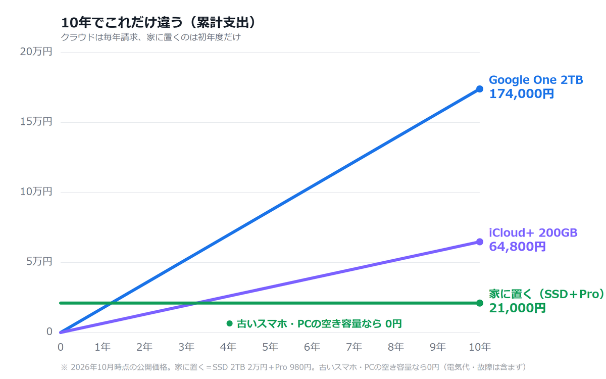

写真の保存先を決めるとき、いちばん迷うのは「結局どれが安いのか」だと思います。料金はサービスごとに書き方が違い、容量もバラバラで比べにくい。ここでは2TB・10年という同じ条件に揃えて、3つの選択肢を並べます。

## 先に結論

2TBを10年使う前提だと、クラウドは約17.4万円、外付けSSDは約2.1万円。差は約15.3万円です。

ただし安さだけでは決まりません。手間とリスクも含めて比べます。

## 3つの選択肢

### 1. クラウド（Google One / iCloud+）

- 2TBで月1,450円（Google One）。10年で約17.4万円
- 初期費用ゼロ。設定は数分で終わる
- 通信があればどこでも見られる
- 反面、払い続ける限り費用は積み上がる

### 2. 外付けSSD＋買い切りアプリ

- 2TBのSSDが約2万円。アプリが買い切り980円。合計約2.1万円
- 10年で見ると、クラウドとの差は約15.3万円
- 初期投資は必要だが、その後は基本的に追加費用なし
- 反面、自分でバックアップを回す手間がある

外付けSSDを使う場合、自動でコピーを回すアプリが必要です。
私は ShareOrBackup を作って使っています。
→ https://sharebackup6.github.io/?utm_source=note&utm_medium=article&utm_campaign=storage-compare

### 3. 家にあるものを使う（古いスマホ・PCの空き容量）

- 追加費用はゼロ
- 古いスマホ：予備機があれば一番手軽。microSDがあればさらに余裕
- PCの空き容量：Windowsの共有フォルダを保存先にできる。すでに電源がついていることが多いので、置き場所として合理的
- 反面、容量はその端末の空き次第。故障リスクは残る

## 向き不向き

- 手軽さを優先する → クラウド
- 10年単位の費用を抑えたい → 外付けSSD
- 追加費用をかけたくない → 古いスマホ、PCの空き容量

## 見落としやすい点

安さの比較には、電気代と故障リスクが含まれていません。SSDや古いスマホは壊れる前提で、大事な写真は2か所に置くのが安全です。

つまり「クラウドをやめる＝1か所にまとめる」ではなく、「家の中に複数の置き場所を作る」と考えるほうが実態に近いです。

## 移行の手順

1. いま写真が何GBあるか確認する（設定のストレージ画面で分かります）
2. 保存先を決めて、まず1つのフォルダだけ移す
3. スマホ側は「消さずに残す」。1か月動いてから整理する

一気に全部を移そうとすると、途中で止まりがちです。最初は写真フォルダだけ、で十分間に合います。

## まとめ

- 2TB・10年なら、クラウドとSSDで約15万円の差
- 追加費用ゼロなら、古いスマホかPCの空き容量
- ただし手間とリスクは別で考える
- 大事な写真は2か所に置く

---

保存先を家の中に決めたら、あとは自動にしておくと続きます。同じWi-Fiにつなぐだけで、スマホの写真をPCやNASへ自動でコピーするアプリを作っています。

[ShareOrBackup（無料・広告なし・月額なし）](https://sharebackup6.github.io/?utm_source=zenn&utm_medium=article&utm_campaign=storage-compare)
